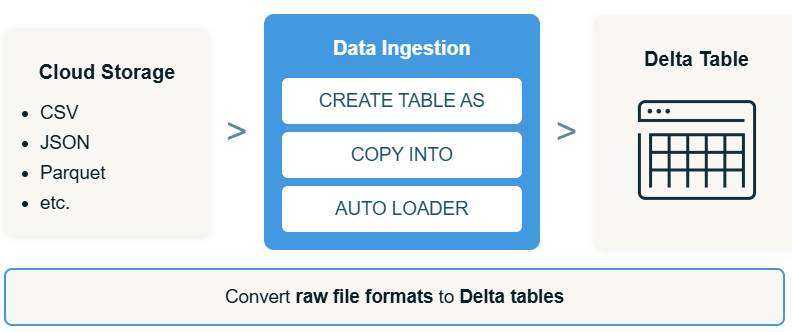
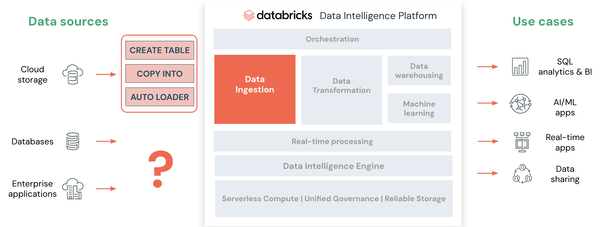
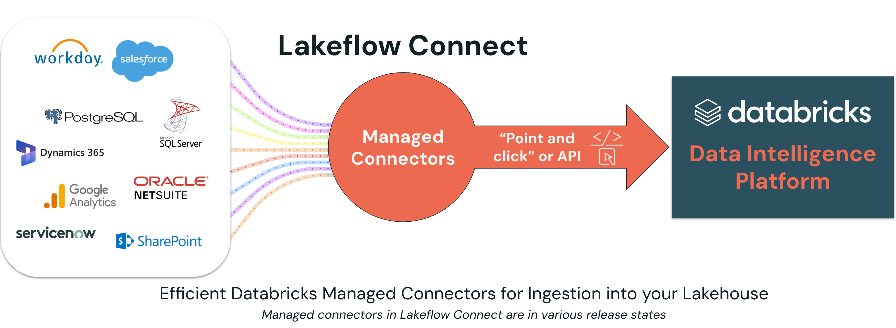
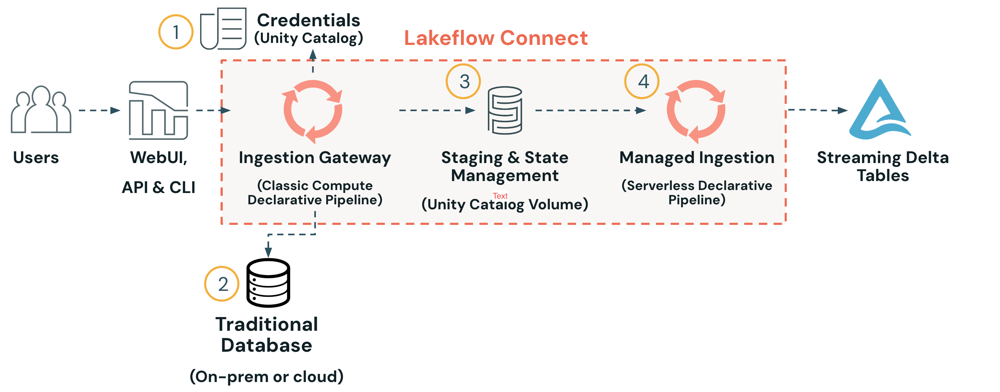
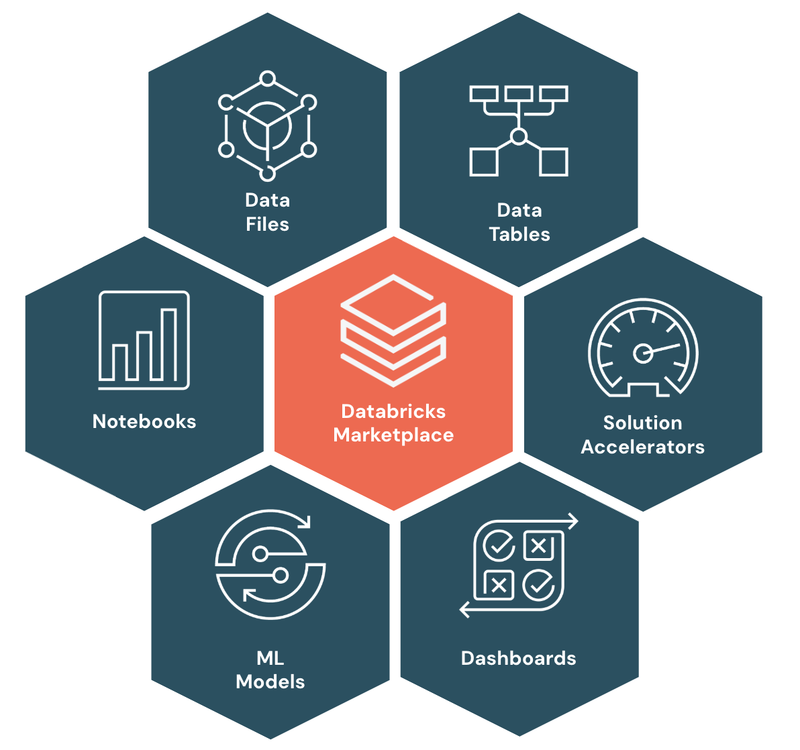
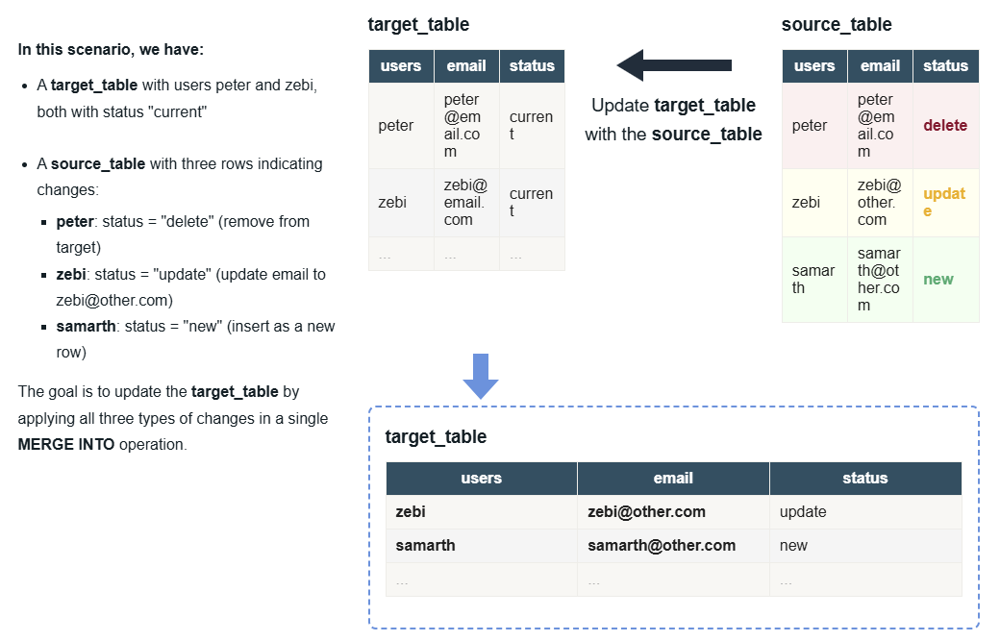

# Welcome to my Data Ingestion with Lakeflow Connect

### This is sponsored by Databricks Academy.

## Info
This contains my note-taking activities during the course.

## Lesson 1 Summary:
In this lecture, you learned the fundamentals of data engineering in Databricks with a focus on LakeFlow Connect and Delta Lake:

1. LakeFlow Connect is the ingestion layer within the Databricks Data Intelligence Platform that replaces the traditional patchwork of ingestion tools with a unified, managed solution.
2. LakeFlow Connect provides three types of connectors: Upload Files, Standard Connectors, and Managed Connectors, each designed for different data source types.
3. Three ingestion methods are available: Batch (processes all records), Incremental Batch (processes only new records), and Streaming (continuous, near real-time ingestion).
4. Delta Lake is an open-source protocol that stores data as Parquet files with transaction logs, enabling ACID transactions, time travel, DML support, and schema enforcement.
5. The Medallion Architecture (Bronze, Silver, Gold) progressively improves data quality as it moves through each layer.

## Data Ingestion from Cloud Storage

**Patterns (from Databricks)**

> **CREATE TABLE AS**

Supports reading file formats like:
| JSON | CSV | XML | TEXT | BINARYFILE | PARQUET | AVRO | ORC
```sql
CREATE TABLE new_table AS
    SELECT *
    FROM read_files(
    <path_to_file(s)>,
    format => '<file_type>',
    <other_format_specific_options>
    );
```

> **COPY INTO**
```sql
CREATE TABLE new_table;
        
COPY INTO new_table
FROM '<dir_path>'
FILEFORMAT = <file_type>
FORMAT_OPTIONS (<options>)
COPY_OPTIONS (<options>)
```

> **AUTOLOADER**
```python
(spark
  .readStream
    .format("cloudFiles")
    .option("cloudFiles.format", "json")
    .option("cloudFiles.schemaLocation", "<checkpoint_path>")
    .load("/Volumes/catalog/schema/files")
  .writeStream
    .option("checkpointLocation", "<checkpoint_path>")
    .trigger(processingTime="5 seconds")
    .toTable("catalog.database.table")
)
```

With SDP
```sql
CREATE OR REFRESH STREAMING TABLE
  catalog.schema.table
SCHEDULE EVERY 1 HOUR
AS
SELECT *
FROM STREAM read_files(
  '<dir_path>',
  format => '<file_type>'
)
```

## Appending Metadata Columns on Ingest

Databricks [`File Metadata Column`](https://docs.databricks.com/aws/en/ingestion/file-metadata-column) Documentation

Samples:

> `Add last file modification timestamp` (_metadata.file_modification_time – provides the last modification timestamp of the input file)
```sql
_metadata
.file_modification_time
```

> `Add input file name` (_metadata.file_name – returns the name of the source file for each row)
```sql
_metadata
.file_name
>
part-00002-7573-1-c000.file_name
```

## Working with the Rescued Data Column

Ingestion techniques like `read_files()`, `spark.read`, or `Auto Loader` provide a rescued data column during ingestion:

The rescued data column ensures that columns that do not match the schema are rescued instead of being dropped
Mismatched values are stored as JSON-formatted strings in the `_rescued_data` column
If a row has no schema mismatches, the _rescued_data column will be null
This preserves all input data and prevents silent data loss

## Ingesting Semi-Structured Data JSON

> JSON-Formatted String Column Methods
1. `STRING` Data Type
One technique for working with a JSON-formatted string column is to access values directly from the STRING data type column.
A column can simply store JSON data as a plain STRING
Since it is stored as a string, the column can hold any JSON string without constraints
However, this approach is less performant compared to typed approaches like STRUCT
To access subfields within JSON-formatted string columns, you can use the colon (:) syntax.

For example, if your column is named json_column, and you want to access the subfield "name", you would specify it as: json_column:name

This syntax allows you to extract specific fields directly from the JSON string stored in the column.

2. `STRUCT` Data Type
Another method to work with a JSON-formatted string column is to convert the column to a STRUCT data type.
You can parse JSON data into a STRUCT type by defining a schema
The STRUCT enforces the JSON schema, ensuring data types and structure are consistent
Querying a STRUCT is more efficient than working with a raw JSON-formatted STRING.

3. `VARIANT` Data Type
The VARIANT data type is the newest approach for working with JSON data in Databricks.
As of 2025 Q2, VARIANT is in public preview. Key benefits include:

Can store any type of data, including JSON, making it ideal for semi-structured data
Highly flexible, adapting to different data shapes without rigid schemas
Offers improved performance over existing methods (STRING and STRUCT)
Keep an eye out for its General Availability (GA) release.

> Converting JSON Formatted Strings as STRUCTS
```json
{
 "name": "John Doe",
 "age": 35,
 "address": {
  "city": "Anytown",
  "state": "CA"
  },
 "children": [
  {
  "name": "Owen",
  "age": 10
  },
  {
  "name": "Eva",
  "age": 8
  }
 ]
}
```

```text
STRUCT<
 name: STRING,
 age: INT,
 address: STRUCT<
  city: STRING,
  state: STRING
  >,
 children: ARRAY<
  STRUCT<
  name: STRING,
  age: INT
  >
 >
>
```

> Deriving the Schema with `schema_of_json`

```sql
SELECT schema_of_json('sample-json-string')
```

> Parsing JSON with `from_json`
```sql
SELECT from_json(json_col, 'json-struct-schema') AS struct_column FROM table
```

Sample:
```python
# Sample JSON record representing a single user from the historical dataset.
# This string can be passed directly to schema_of_json() to derive its schema.
json_string = '{"user_id": 1, "full_name": "Alice Johnson", "email": "alice.johnson@example.com", "age": 34, "is_active": true, "signup_date": "2023-01-15", "last_login": "2024-06-30T14:22:11", "account_balance": 1520.75, "address": {"street": "123 Main St", "city": "Austin", "state": "TX", "zip_code": "78701", "country": "USA"}, "phone_numbers": ["555-0100", "555-0199"], "preferences": {"newsletter": false, "language": "en-US", "timezone": "America/Chicago"}, "order_ids": [101, 102, 115]}'

# Derive the schema using schema_of_json()
display(spark.sql(f"SELECT schema_of_json('{json_string}') AS schema"))
"""
STRUCT<account_balance: DOUBLE, address: STRUCT<city: STRING, country: STRING, state: STRING, street: STRING, zip_code: STRING>, age: BIGINT, email: STRING, full_name: STRING, is_active: BOOLEAN, last_login: STRING, order_ids: ARRAY<BIGINT>, phone_numbers: ARRAY<STRING>, preferences: STRUCT<language: STRING, newsletter: BOOLEAN, timezone: STRING>, signup_date: STRING, user_id: BIGINT>"""
```
Use it in reading the parquets:
```python
# Define the schema derived from schema_of_json()
json_schema = 'STRUCT<account_balance: DOUBLE, address: STRUCT<city: STRING, country: STRING, state: STRING, street: STRING, zip_code: STRING>, age: BIGINT, email: STRING, full_name: STRING, is_active: BOOLEAN, last_login: STRING, order_ids: ARRAY<BIGINT>, phone_numbers: ARRAY<STRING>, preferences: STRUCT<language: STRING, newsletter: BOOLEAN, timezone: STRING>, signup_date: STRING, user_id: BIGINT>'

# Create the bronze table from the JSON files in the volume, applying the derived schema
spark.sql(f"""
              CREATE OR REPLACE TABLE bronze_users AS
              SELECT * FROM read_files(
                  '{VOLUME}',
                  format => 'json',
                  schema => '{json_schema}'
              )
          """)

display(spark.sql("SELECT * FROM bronze_users"))
```

## Ingesting Enterprise Data Overview

From official Databricks Academy documents.





## Additional Features and Ingesting into Existing UC tables

> Ingesting Data with Databricks Marketplace



> Delta Sharing with Databricks Marketplace

> Updates, Inserts, and Deletes on Delta Tables with MERGE INTO



Syntax:
```sql
-- Declare Target and Source Table
MERGE INTO target_table target
USING source_table source
-- Specify the condition for merging
ON target.id = source.id
-- First WHEN clause for merge
WHEN MATCHED AND source.status = 'update' THEN
  UPDATE SET
    target.email = source.email,
    target.status = source.status
-- Second WHEN clause for merge
WHEN MATCHED AND source.status = 'delete' THEN
  DELETE
-- WHEN NOT MATCHED clause for merge
WHEN NOT MATCHED THEN
  INSERT (id, first_name, email, sign_up_date
  status)
```

## Certificate
Completion [`certificate`](cert/Data%20Ingestion%20with%20Lakeflow%20Connect%20-%20Databricks.pdf) from Databricks Academy.